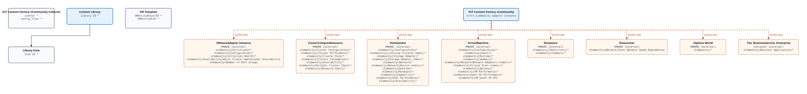

# VCF Content Factory vCommunity Documentation

> Generated index. The SVG diagram and per-kind table are regenerated on every
> build; prose sections (overview, installing) are hand-curated.

## Contents

| Section | Description |
|---------|-------------|
| [Overview](overview.md) | What's in the pack, resource kinds, cross-adapter notes |
| [Installing & Configuring](installing.md) | Prerequisites, configuration fields, step-by-step guide |
| [Inventory Tree](inventory-tree.md) | Traversal spec, per-kind table with identifying keys |
| [Metrics Reference](../REFERENCE.md) | Full metrics and properties reference (generated) |

## Inventory Tree

## Metrics Pushed Onto

This pak pushes keys onto resource kinds owned by other management packs, through the Suite API at collection time. `describe.xml` cannot declare keys on another adapter's kinds, so the targets are declared in `adapter.yaml` (`stitch_targets`) and listed here.

### VMwareAdapter Instance (VMWARE)

- **Matched on:** VMEntityVCID (the vCenter's about.instanceUuid); exactly one object must carry it, otherwise the keys are held back and counted

| Key group |
|-----------|
| `vCommunity\|Collection Health\|*` |

## Quick Reference

- **Adapter kind:** `vcfcf_vcommunity`
- **Version:** 0.0.0.3
- **Traversal spec:** (none)
- **Resource kinds:** 4
- **Metrics pushed onto:** VMwareAdapter Instance (VMWARE) (see [Metrics Pushed Onto](#metrics-pushed-onto))
